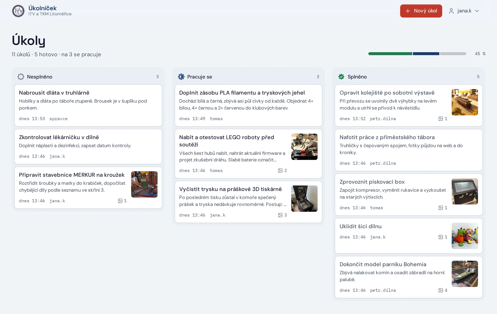
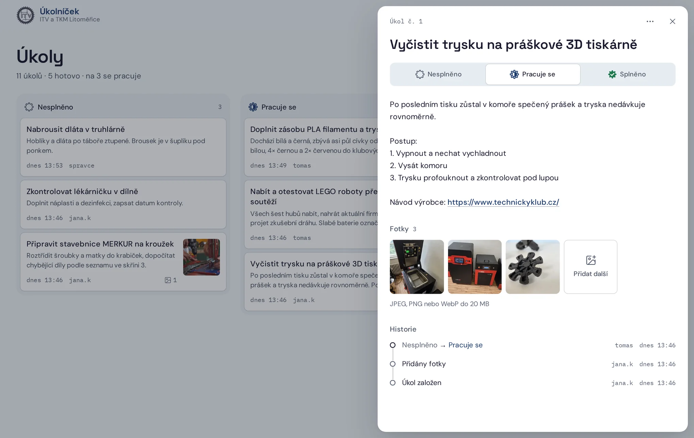
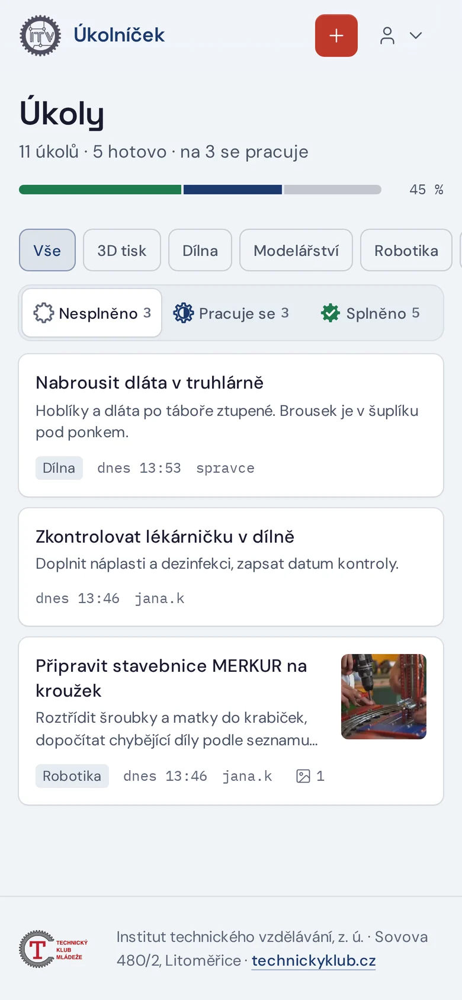
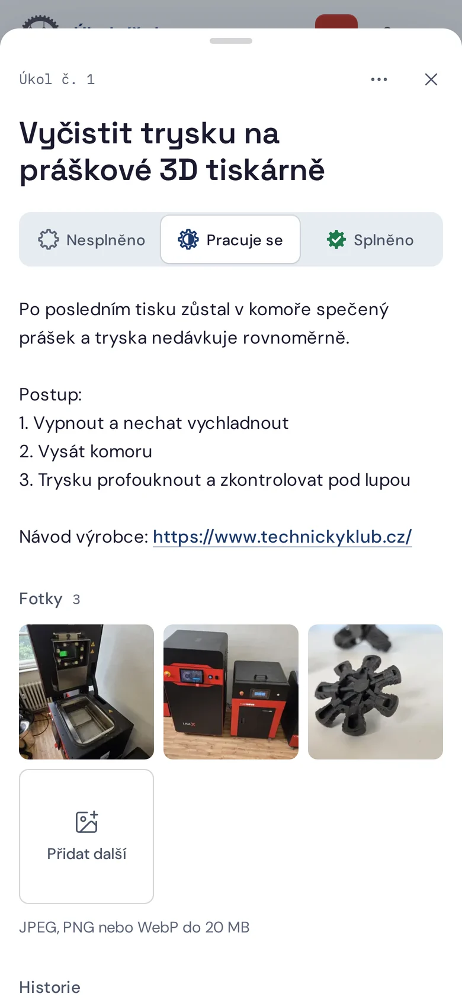
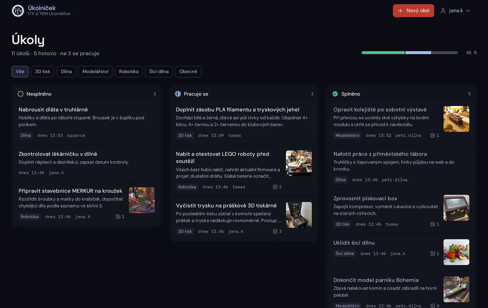

# Úkolníček ITV a TKM Litoměřice

Webová nástěnka úkolů pro Technický klub mládeže a Institut technického vzdělávání v Litoměřicích. Úkol je buď nesplněný, pracuje se na něm, nebo je splněný. Dá se rozkliknout, má popis, fotky a historii změn.

- **Kdokoliv** si může úkoly a fotky prohlížet.
- **Schválení členové** úkoly zakládají, upravují, mění jejich stav a přidávají fotky.
- **Správce** schvaluje nové registrace, spravuje účty a zakládá místnosti.

Úkoly jde rozdělit podle místností (Robotika, Dílna…). Na nástěnce si pak každý nechá zobrazit všechno, nebo jen vybrané místnosti.

Rozhraní je česky a drží se vizuálu [technickyklub.cz](https://www.technickyklub.cz/): barvy, písma i obě loga.

## Ukázka





<p>
  
  
</p>



Snímky ukazují smyšlené úkoly a účty. Fotky v nich pocházejí z webu technickyklub.cz.

## Spuštění

Potřebujete stroj s Dockerem (včetně Docker Compose) a gitem.

```bash
git clone https://github.com/AgentKosticka/tkm-ukoly.git
cd tkm-ukoly
cp .env.example .env
docker compose up -d --build
```

Web pak běží na portu 80 tohoto stroje.

Repozitář klonujte přes HTTPS, ne přes SSH. Aktualizační služba SSH klíče nemá; k soukromému repozitáři se dostane tokenem (`GIT_TOKEN` v `.env`).

### První přihlášení

Při prvním startu se založí účet správce `admin`. Heslo najdete v logu:

```bash
docker compose logs app | grep -A3 "Vytvořen účet správce"
```

Po přihlášení si ho musíte hned změnit. Kdo chce heslo určit sám, vyplní před prvním startem v `.env` položku `ADMIN_PASSWORD` (aspoň 10 znaků).

### HTTPS

Bez domény běží web přes nešifrované HTTP. To stačí na vyzkoušení v místní síti, ale hesla po cestě nic nechrání. Pro ostrý provoz nastavte v `.env` doménu, která míří na váš server:

```
SITE_ADDRESS=ukoly.example.cz
```

a spusťte `docker compose up -d`. Caddy si certifikát obstará a obnovuje sám. Porty 80 a 443 musí být dostupné z internetu.

Nemá-li server veřejnou adresu, použijte režim za tunelem popsaný níže.

### Za tunelem (Cloudflare Tunnel, Tailscale Funnel…)

Když server nemá veřejnou adresu nebo na něm nechcete otevírat porty, může web zveřejnit tunel. V tomto režimu Úkolníček poslouchá na jediném portu přes obyčejné HTTP, a to jen na místní smyčce (`127.0.0.1:8080`). HTTPS a certifikát obstará tunel; porty 80 a 443 se nevystavují.

V `.env` nastavte:

```
COMPOSE_FILE=compose.yml:compose.tunnel.yml
TUNNEL_PORT=8080
PUBLIC_ORIGIN=https://ukoly.example.cz
```

a spusťte `docker compose up -d --build`. Potom zkontrolujte, že je vystavený jen tento jeden port:

```bash
docker compose ps caddy
```

Ve sloupci s porty má být se šipkou jen `127.0.0.1:8080->80/tcp`. Kdyby tam byly i položky jako `0.0.0.0:80->80/tcp` nebo `0.0.0.0:443->443/tcp`, režim se nezapnul celý (nejspíš kvůli staré verzi Docker Compose) a web takhle neprovozujte.

Tunel pak nasměrujte na `http://localhost:8080`:

- **Cloudflare Tunnel:** u veřejné adresy tunelu zvolte službu typu HTTP s adresou `localhost:8080`.
- **Tailscale Funnel:** `tailscale funnel --bg 8080`.

Běží-li tunel sám v kontejneru, na `localhost` hostitele nedosáhne. Připojte ho do sítě `tkm-ukoly_outside` a jako cíl zadejte `http://caddy:80`.

Na co si dát pozor:

- **`PUBLIC_ORIGIN` vyplňte.** Je to adresa, kterou vidí návštěvník. Aplikace podle ní kontroluje původ požadavků a nemusí se spoléhat na hlavičky od tunelu.
- **Tunel musí být proxy pro HTTP**, která sama doplní hlavičky `X-Forwarded-For` a `X-Forwarded-Proto`. Cloudflare Tunnel, Tailscale Funnel i ngrok to dělají. Za adresu návštěvníka se bere poslední položka, kterou do `X-Forwarded-For` připsal tunel. Holé přeposílání TCP nestačí: aplikace by adresu návštěvníka neznala a ten by ji mohl podvrhnout.
- **Port nezveřejňujte.** Kdo se na něj dostane přímo, mimo tunel, může si adresu v hlavičkách vymyslet a obejít tak brzdu na hádání hesel. Proto port ve výchozím stavu poslouchá jen na místní smyčce. Když tunel běží na jiném stroji, nastavte `TUNNEL_BIND` a port zavřete firewallem pro všechny ostatní.
- Položky `SITE_ADDRESS`, `HTTP_PORT` a `HTTPS_PORT` se v tomto režimu nepoužijí.
- Je potřeba Docker Compose z roku 2024 nebo novější, který zná značku `!override`; tou se seznam portů nahrazuje.

Zpět na běžný režim se vrátíte smazáním řádku `COMPOSE_FILE` a novým `docker compose up -d`.

### Fotky na jiném disku

Fotky jsou běžně ve svazku Dockeru u ostatních dat. Položkou `PHOTOS_DIR` v `.env` je jde uložit do libovolné složky na serveru, třeba na větší disk:

```
PHOTOS_DIR=/mnt/velky-disk/ukolnicek-fotky
```

Postup:

1. Složku vytvořte a předejte uživateli 1000, pod kterým aplikace v kontejneru běží:

   ```bash
   mkdir -p /mnt/velky-disk/ukolnicek-fotky
   chown 1000:1000 /mnt/velky-disk/ukolnicek-fotky
   ```

2. Když už v Úkolníčku nějaké fotky jsou, zastavte aplikaci a zkopírujte je do nové složky. Jinak by se po přepnutí nezobrazily; a fotka nahraná během kopírování by se ztratila:

   ```bash
   docker compose stop app
   docker run --rm -v tkm-ukoly_data:/data:ro -v /mnt/velky-disk/ukolnicek-fotky:/cil alpine \
     sh -c 'cp -a /data/photos/. /cil/ && chown -R 1000:1000 /cil'
   ```

3. Zapište `PHOTOS_DIR` do `.env` a spusťte `docker compose up -d`.

Na co si dát pozor:

- Cesta musí být celá, od lomítka. S poměrnou cestou se aplikace nespustí.
- Když aplikace do složky nesmí zapisovat (špatný vlastník), nespustí se a v logu (`docker compose logs app`) řekne proč. Po startu také upozorní, když ve složce chybí soubory k fotkám, které zná databáze.
- Použijte podsložku disku, ne přímo místo, kam je disk připojený. Když disk při startu serveru připojený nebude, podsložka nebude existovat, Docker ji založí prázdnou pod rootem a aplikace se odmítne spustit. Fotky tak neskončí omylem na systémovém disku.
- Ve složce jsou jen fotky. Databáze, její zálohy a dočasné soubory zůstávají ve svazku `tkm-ukoly_data`.
- Složka může být i na síťovém disku (NAS), který je na serveru připojený, například přes `/etc/fstab`. U připojení SMB nastavte volbami `uid=1000,gid=1000`, komu soubory patří; `chown` tam nefunguje.
- Když síťový disk přestane odpovídat, aplikace běží dál a umí se i znovu spustit. Úkoly fungují, místo fotek je šedé pole s ikonou a nahrávání hlásí, že úložiště není dostupné. Po návratu disku stačí stránku obnovit.
- To platí, dokud disk zůstává na serveru připojený. Když server nastartuje a disk se nepřipojí vůbec, složka chybí, Docker ji založí prázdnou pod rootem a aplikace se nespustí, aby fotky neskončily na systémovém disku. Pomůže disk připojit (`mount` s cestou připojení); aplikace se pak do minuty spustí sama.
- Původní fotky ve svazku po zkopírování zůstanou. Smazat je můžete až po přepnutí, když ověříte, že se všechny zobrazují: `docker compose exec app rm -rf /data/photos`. Bez nastaveného `PHOTOS_DIR` by tento příkaz smazal fotky, které se právě používají.

## Automatické aktualizace

Služba `updater` každých pět minut zjistí, jestli v repozitáři, ze kterého jste projekt naklonovali (`origin`), přibyly změny ve vybrané větvi. Když ano:

1. stáhne je (jen pokud navazují na místní stav),
2. sestaví nové obrazy; stará verze mezitím běží dál,
3. nasadí je a počká, až aplikace odpovídá,
4. když se sestavení nebo start nepovede, vrátí předchozí verzi a vadnou revizi už nezkouší, dokud v repozitáři nepřibude oprava.

Průběh je v logu: `docker compose logs updater`.

**Po prvním nasazení si aktualizace vyzkoušejte:** pošlete do repozitáře drobnou změnu (třeba překlep v README) a sledujte `docker compose logs -f updater`. Do pěti minut má přijít řádek „Nová verze“ a po sestavení „Hotovo“.

Místní neuložené úpravy sledovaných souborů ani přepsanou historii služba nepřepíše; v logu řekne, že je potřeba ruční zásah. Před změnou struktury databáze si aplikace sama uloží zálohu do `/data/backups`.

| Nastavení v `.env` | Význam |
| --- | --- |
| `UPDATE_INTERVAL=300` | Interval kontroly v sekundách. `0` aktualizace vypne. |
| `UPDATE_BRANCH=` | Sledovaná větev. Prázdné znamená větev, která je právě vybraná. |
| `GIT_TOKEN=` | Token pro čtení soukromého repozitáře na GitHubu. |

**Na co si dát pozor:** služba má přístup k Dockeru na hostiteli, což odpovídá právům správce stroje. Kdo může zapisovat do sledované větve, ten ovládá server. Chraňte ji (povinné revize, dvoufázové přihlášení) nebo aktualizace vypněte a nasazujte ručně:

```bash
git pull && docker compose up -d --build
```

Změny v samotné službě `updater` (soubor `deploy/updater/Dockerfile` nebo `loop.sh`) se neprojeví samy. Po nich jednou spusťte `docker compose up -d --build updater`. Postup aktualizace v `update.sh` se čte při každé kontrole znovu, ten se aktualizuje sám.

## Místnosti

Místnosti zakládá správce: v nabídce účtu vpravo nahoře je položka **Místnosti**. Tam je jde přidávat, přejmenovat a mazat.

- Úkol patří nejvýš do jedné místnosti. Vybírá se při založení a dá se kdykoliv změnit v detailu; přesun se zapíše do historie úkolu.
- Úkol bez místnosti je v **Obecné**. Tam jsou i všechny úkoly založené dřív, než místnosti vznikly.
- Nad nástěnkou je řada s místnostmi. „Vše“ ukáže všechno, jinak jde zaškrtnout libovolnou kombinaci místností včetně Obecné. Počty a pruh s podílem hotových úkolů se řídí výběrem.
- Výběr si pamatuje prohlížeč, takže na dílenském tabletu může trvale svítit jen jeho místnost. Filtrovat může i nepřihlášený návštěvník.
- Smazáním místnosti úkoly nezmizí, přesunou se do Obecné.

## Instalace jako aplikace

Úkolníček jde nainstalovat na plochu telefonu, tabletu i počítače (PWA). Otevírá se pak ve vlastním okně bez lišty prohlížeče.

- **Android, Chrome a Edge na počítači:** v patičce stránky se objeví tlačítko **Nainstalovat aplikaci**. Stejnou volbu má i nabídka prohlížeče.
- **iPhone a iPad:** v Safari tlačítko Sdílet a **Přidat na plochu**.

Instalace i běh bez připojení vyžadují HTTPS, tedy nastavenou doménu v `SITE_ADDRESS` nebo provoz za tunelem. Přes obyčejné HTTP funguje Úkolníček jen jako běžná webová stránka.

Bez připojení:

- aplikace se otevře a ukáže nástěnku v posledním načteném stavu, s upozorněním, z kdy ten stav je,
- náhledy fotek, které už zařízení vidělo, se zobrazí,
- detail úkolu, přihlášení a jakékoliv změny připojení potřebují.

Co se v zařízení ukládá: soubory aplikace, naposledy zobrazené fotky (nejvýš 300) a poslední stav nástěnky tak, jak ho vidí nepřihlášený návštěvník, tedy bez jmen členů. Odpovědi serveru pro přihlášené se neukládají, takže na sdíleném tabletu po odhlášení nic osobního nezůstane.

Když je zařízení online, načítá se vždy aktuální verze aplikace; po aktualizaci serveru není potřeba nic přeinstalovat.

## Zálohy

Všechna data jsou ve svazku `tkm-ukoly_data`: databáze `ukoly.db`, fotky ve složce `photos` a denní zálohy databáze za posledních sedm dní ve složce `backups`. S nastaveným `PHOTOS_DIR` jsou fotky ve zvolené složce a zálohovat je potřeba i ji.

Kopii celého svazku do aktuální složky udělá:

```bash
docker run --rm -v tkm-ukoly_data:/data:ro -v "$PWD":/zaloha alpine tar czf /zaloha/ukolnicek-zaloha.tar.gz -C /data .
```

Zálohy ve svazku chrání před poškozením databáze, ne před ztrátou disku. Kopii si pravidelně ukládejte jinam.

## Správa z příkazové řádky

Když se správce nemůže přihlásit:

```bash
docker compose exec app node src/cli.js uzivatele
docker compose exec app node src/cli.js reset-hesla JMENO
docker compose exec app node src/cli.js spravce JMENO
```

`reset-hesla` vypíše dočasné heslo, `spravce` udělá z existujícího účtu schváleného správce.

## Fotky

- Přijímají se jen JPEG, PNG a WebP do 20 MB. Typ se pozná z obsahu souboru, ne z přípony.
- Server každý soubor celý dekóduje. Poškozené soubory, animace a obrázky s obřím rozlišením odmítne.
- Z fotek se odstraní metadata včetně polohy GPS. Zůstane jen barevný profil a orientace.
- Na stránce se zobrazuje náhled (400 px) a u větších fotek zmenšená verze (1600 px), obojí ve WebP.
- **Originál se archivuje beze ztráty.** Fotky větší než 1600 px ve formátu JPEG XL:
  - JPEG se přebalí tak, že je zhruba o pětinu menší a jde z něj vrátit původní soubor bajt po bajtu.
  - PNG a bezeztrátový WebP se uloží po pixelech, typicky na třetinu původní velikosti.
  - Ztrátový WebP zůstává, jak je, protože bezeztrátové překódování by ho několikanásobně zvětšilo.
- Menší obrázky se ukládají jen jednou: jako očištěný původní soubor (nebo bezeztrátový WebP), který se rovnou i zobrazuje. Zvláštní kopie pro zobrazení by u nich zabrala skoro tolik místa jako ony samy.
- Server po zakódování archiv rozbalí a porovná s předlohou. Když nesedí nebo není menší, uloží očištěný původní soubor, takže archiv není větší než nahraná fotka. Výjimkou jsou dva vzácné případy, kdy soubor nejde očistit bez překódování a ukládají se pixely: JPEG s nestandardní strukturou a ztrátový WebP otočený přes EXIF.
- Originál si přihlášený člen stáhne v prohlížeči fotek tlačítkem „Originál“.
- Když se fotka nepodaří načíst (chybí soubor, úložiště fotek není dostupné), zůstane na jejím místě šedé pole s ikonou.

Kolik to dělá: fotka z mobilu o velikosti 1,5 MB zabere na disku zhruba 1,4 MB (archiv 1,2 MB a k němu zmenšená verze s náhledem, dohromady kolem 0,2 MB). U větších fotek je úspora výraznější, u obrázků kolem 0,5–1 MB vyjde součet o něco větší než nahraný soubor. Víc bez ztráty kvality ušetřit nejde; JPEG je sám o sobě už hodně stlačený.

Kódování do JPEG XL potřebuje zhruba 25–50 MB paměti na megapixel. Fotky nad 24 megapixelů se proto ukládají jako očištěný JPEG nebo PNG; hranici mění `JXL_MAX_MEGAPIXELS`.

## Zabezpečení

- Hesla se ukládají jako otisk scrypt (N = 2¹⁶, r = 8, p = 2). Minimum je 10 znaků.
- Přihlášení drží cookie `HttpOnly`, `SameSite=Strict`, přes HTTPS navíc `Secure` s prefixem `__Host-`. V databázi je jen otisk tokenu.
- Stav účtu se čte z databáze při každém požadavku. Zablokování nebo odebrání práv platí okamžitě.
- Požadavky, které něco mění, musí přijít ze stejné adresy a nést vlastní hlavičku (ochrana proti CSRF).
- Přísná Content-Security-Policy: stránka nenačítá nic z cizích serverů, písma i ikony jsou součástí aplikace.
- Service worker ukládá jen veřejné soubory aplikace a fotky. Na adresy API nesahá.
- Po pěti špatných heslech se přihlášení z dané adresy na daný účet na 15 minut zablokuje. Účet se nezamyká jen podle jména, aby ho nešlo odstavit hádáním.
- Jména členů vidí jen přihlášení. Návštěvník vidí úkoly, fotky a místnosti bez autorů.
- Aplikace běží v kontejneru bez práv roota, se souborovým systémem jen pro čtení a bez přístupu do internetu. Ven je vystavený jen Caddy; v režimu za tunelem jen na místní smyčce.

Bez e-mailu nejde heslo obnovit samoobslužně. Zapomenuté heslo řeší správce: v seznamu uživatelů vytvoří dočasné, které si člen po přihlášení změní.

## Nastavení

Všechno se nastavuje v souboru `.env`; popis položek je v [.env.example](.env.example).

| Proměnná | Výchozí | Význam |
| --- | --- | --- |
| `SITE_ADDRESS` | `:80` | Doména pro HTTPS, nebo `:80` pro HTTP. |
| `HTTP_PORT`, `HTTPS_PORT` | `80`, `443` | Porty na hostiteli. |
| `ADMIN_USERNAME`, `ADMIN_PASSWORD` | `admin`, náhodné | První správce. |
| `UPDATE_INTERVAL`, `UPDATE_BRANCH`, `GIT_TOKEN` | `300`, prázdné, prázdné | Automatické aktualizace. |
| `COMPOSE_FILE` | prázdné | `compose.yml:compose.tunnel.yml` zapne režim za tunelem. |
| `TUNNEL_PORT` | `8080` | Port v režimu za tunelem. |
| `TUNNEL_BIND` | `127.0.0.1` | Adresa hostitele, na které port v režimu za tunelem poslouchá. |
| `TUNNEL_PROXIES` | místní a soukromé rozsahy | Adresy tunelu, jejichž hlavičkám `X-Forwarded-*` se věří. |
| `PHOTOS_DIR` | prázdné | Složka na serveru pro fotky. Prázdné znamená svazek Dockeru u ostatních dat. |
| `PROXY_SUBNET` | `172.30.99.0/29` | Vnitřní síť mezi Caddy a aplikací. |
| `PUBLIC_ORIGIN` | prázdné | Pevná veřejná adresa pro kontrolu původu požadavků. Za tunelem ji vyplňte. |
| `JXL_MAX_MEGAPIXELS` | `24` | Největší fotka archivovaná v JPEG XL. |

## Vývoj

Potřebujete Node.js 22.12 nebo novější.

```bash
npm ci
npm run dev
```

Aplikace běží na `http://localhost:3000` a data ukládá do složky `data`. Heslo správce se vypíše do konzole.

```bash
npm test
sh deploy/updater/test.sh
```

Bez nástrojů `cjxl` a `djxl` (balík `libjxl-tools`) se originály ukládají záložní cestou; testy projdou v obou případech. Celou sadu ve stejném prostředí jako v provozu pustí `docker build --target test .`

```
src/                 server: účty, úkoly, fotky
public/              rozhraní: čisté ES moduly a CSS, bez sestavovacího kroku
test/                testy serveru
deploy/              Caddy a aktualizační služba
docs/                snímky pro tento přehled
compose.yml          provozní sestava
compose.tunnel.yml   úprava sestavy pro režim za tunelem
```

## Licence třetích stran

- Písma DM Sans, Space Grotesk a IBM Plex Mono: SIL Open Font License 1.1.
- Ikony: [Lucide](https://lucide.dev), licence ISC.
- Loga ITV a TKM patří Institutu technického vzdělávání, z. ú.
